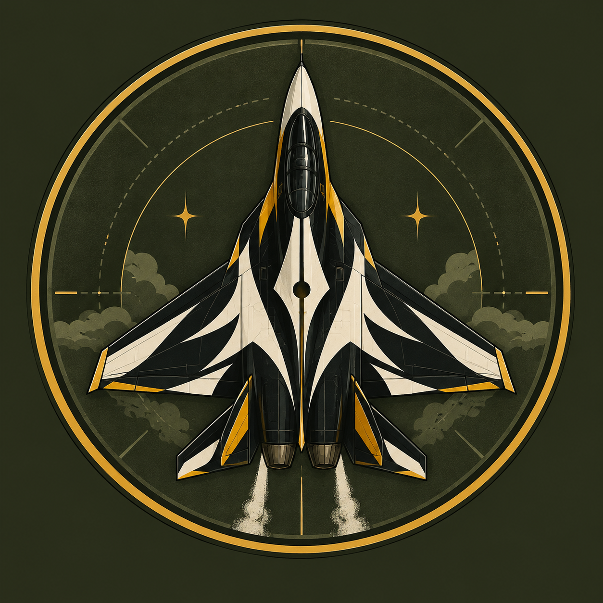

  

  
   
  바이브 코딩으로 학교 업무 도구를 만드는 국어 교사

---

### ✈️ 비행 기록 · Flight log

| 기체 (프로젝트) | 임무 | 상태 |
|---|---|---|
| **자리 배치 프로그램** | 나이스 엑셀 연동, 무작위 섞기, 좌석 고정·교환, 인쇄 |  |
| **야자 관리 시스템** | 야간자율학습 출석 체크와 통계 |  |
| **출결서류 생성기** | 나이스 출결 엑셀로 결석·인정·기타 출결 신고서(hwpx) 생성 |  |

※ 기밀 기체는 학생 정보를 다루기 때문에 코드를 공개하지 않습니다.

### 🧰 탑재 장비 · Loadout

### 📡 관제탑 · Contact

연락처 준비 중
